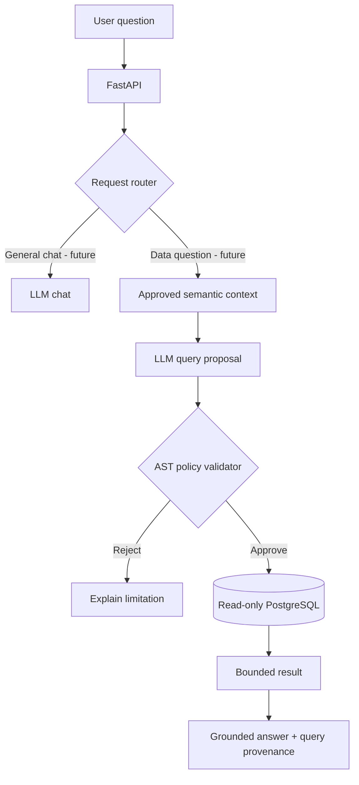

# Governed AI Analytics Architecture

**A secure, semantic-aware foundation for natural-language analytics.**

This independent, public-ready project explores a simple principle: **the LLM may propose a query; trusted application code decides whether and how it runs.** It is not affiliated with any organization or internal application.

> Status: Phase 0 scaffold. No LLM, live database connector, or agent execution is wired yet. Nothing in this repository should be treated as production-ready.

## Problem

Business questions are written in natural language; business facts live in structured databases. Generic text-to-SQL prototypes can hallucinate table relationships, use poorly defined metrics, or issue unsafe queries. This project combines curated semantics with deterministic backend policy, least-privilege execution, and transparent answers.

## Proposed request flow



## Planned stack

- Python + FastAPI, Pydantic
- SQLGlot for structural SQL analysis
- PostgreSQL for synthetic business data and curated semantic catalog
- Pluggable OpenAI-compatible LLM interface (later)
- React + TypeScript frontend (later)
- pytest + GitHub Actions for automated verification

## Current scaffold

- `GET /health` (local service health only)
- `GET /api/v1/info` (project capabilities and implementation status)
- Deny-by-default SQL query policy prototype; **not used to grant database access**
- Initial tests and CI checks

## Local development

Requirements: Python 3.11+

```bash
cd backend
python -m venv .venv
source .venv/bin/activate  # On Windows: .venv\Scripts\activate
pip install -r requirements.txt
uvicorn app.main:app --reload
```

Open http://127.0.0.1:8000/docs.

Run tests from `backend/`:

```bash
pytest -q
```

## Milestones

1. **Phase 0:** public-safe repo, baseline API and tests — scaffold included.
2. **Phase 1:** synthetic commerce dataset, curated semantic catalog, read-only PostgreSQL adapter.
3. **Phase 2:** narrow natural-language-to-SQL workflow, AST allowlists, authorization, result caps.
4. **Phase 3:** answer provenance, test questions, evaluation of correctness/security.
5. **Phase 4:** analytics UI, chart recommendations, optional agentic multi-step planning.

See [architecture](docs/ARCHITECTURE.md), [security](docs/SECURITY.md), and [roadmap](docs/ROADMAP.md).

## Responsible development

Only synthetic, openly licensed, or otherwise explicitly approved datasets should be used. Do not upload employer source code, schema dumps, internal prompts, credentials, or confidential metrics. The architectural ideas here are generic and independently implemented.

## License

MIT — see [LICENSE](LICENSE).
